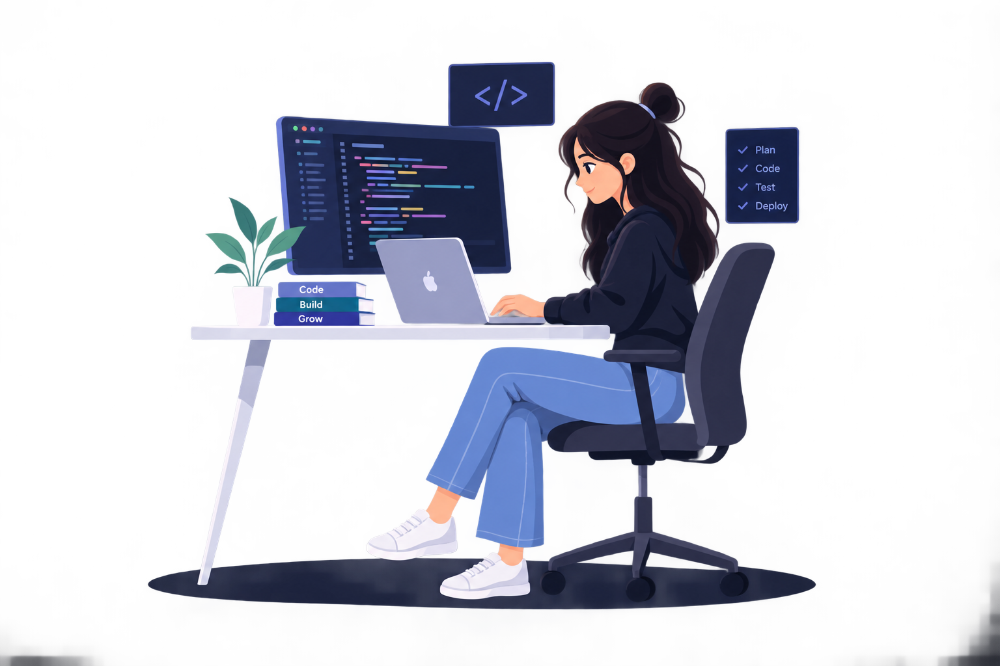

  

<table>
  <tr>
    <td width="58%" valign="middle">
      <h1>Hi, I'm Sakshi Shewale 👋</h1>
      

        
      

      

        I’m a third-year <b>B.Tech Computer Engineering student at MIT Academy of Engineering, Pune</b>, interested in software development, problem-solving, and creating practical applications.
      

      

        
        
        
      

    </td>
    <td width="42%" align="center" valign="middle">
      
    </td>
  </tr>
</table>

  

👩‍💻 About Me
- 🎓 Third-year B.Tech Computer Engineering student at MIT Academy of Engineering, Pune.
- 💻 Practicing problem-solving and Data Structures & Algorithms with C++.
- 🌐 Learning to build full-stack web applications.
- 🤖 Exploring AI and new technologies through hands-on projects.
- 🚀 Focused on improving my coding skills and preparing for software development internships.
- 🤝 Enjoy collaborating, sharing ideas, and learning from other developers.
🧰 Tech Stack
Languages

  

Frontend

  

Backend & Databases

  

Tools & Platforms

  

📈 GitHub at a Glance

  
  

  

🤝 Let's Connect

  
  
  

  <i>“Learn consistently. Build thoughtfully. Improve every day.”</i>
    
  <b>✨ Thanks for visiting my profile! ✨</b>
   
  If you find something interesting, feel free to explore my repositories or connect with me.

